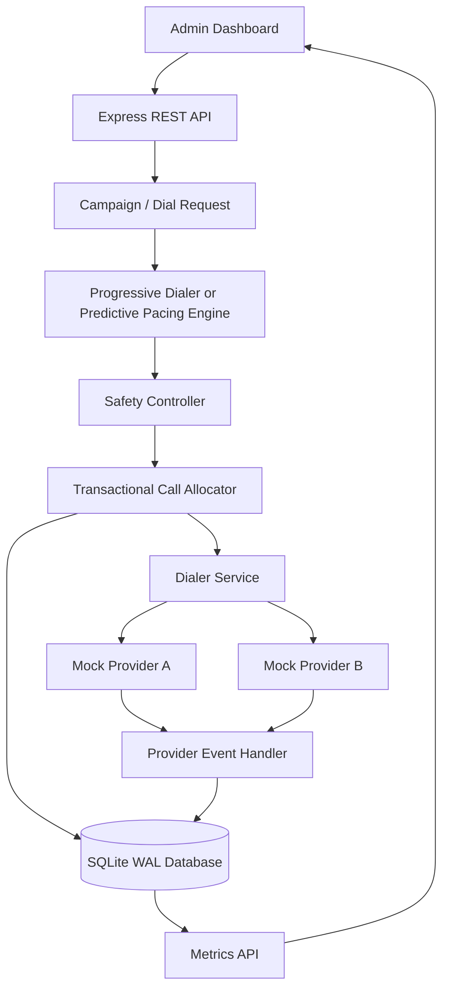

# Architecture

## 1. System Architecture



## 2. Safety Boundary

The predictive engine only proposes a dial count. It cannot call a provider directly.

The Safety Controller evaluates the proposal against the number of currently available agents and queued borrowers.

The Transactional Call Allocator performs the safety evaluation and reserves agents and borrowers within the same database transaction.

The allocator ensures that:

- Only AVAILABLE agents are reserved.
- Only QUEUED borrowers are selected.
- Each reservation is checked before proceeding.
- A failed reservation rolls back the transaction.
- A partial unique database index provides additional protection against multiple live calls assigned to one agent.

The Dialer Service initiates provider calls only after successful reservations.

## 3. Why SQLite for This Prototype?

SQLite keeps the prototype easy to run locally and supports:

- Database transactions
- Constraints and indexes
- Write-Ahead Logging (WAL)
- Busy timeout configuration

A production multi-host deployment should move to PostgreSQL and use appropriate row-level locking or atomic conditional updates, with a durable job queue and provider webhook inbox.

## 4. Failure Behaviour

- **Provider timeout:** The call is marked FAILED; the agent returns to WRAP_UP and the borrower returns to the queue.
- **Duplicate event:** A unique event_id prevents duplicate processing.
- **Out-of-order event:** The transition graph rejects the transition and records an ignored-event metric.
- **Worker process crash:** Reserved and in-flight records remain durable. A production recovery worker should scan expired reservations and reconcile provider status before retrying.
- **Agent availability drop:** New reservations only use agents currently AVAILABLE; existing live calls are not reassigned.

## 5. Scaling Bottlenecks

1. **Single SQLite writer / write contention:** Migrate to PostgreSQL.
2. **Polling dashboard:** Use WebSockets or Server-Sent Events.
3. **Provider webhook volume:** Introduce a durable queue and partitioned event processing.
4. **Campaign-level hot rows:** Shard by campaign and use bounded worker leases.
5. **Analytics queries:** Stream events to a warehouse rather than burdening the OLTP database.

## 6. Current Prototype Limitations

- Telecom providers are mocked.
- Predictive pacing uses a conservative safety cap based on currently available agents.
- Provider calls are initiated in-process.
- Authentication and provider webhook signature verification are not implemented.
- Worker crash recovery and provider reconciliation are production next steps.
```
