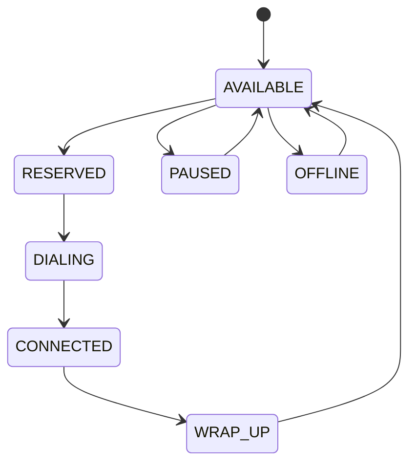
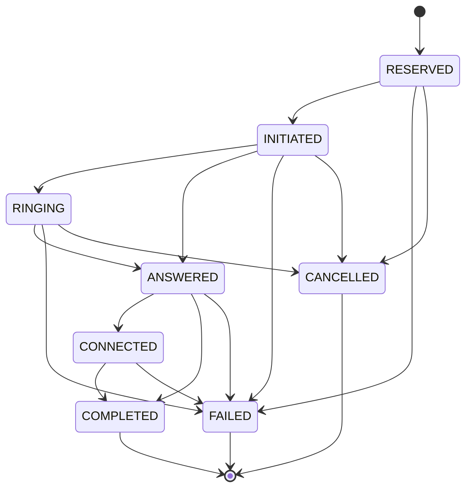

# State Machines

## 1. Agent State Machine

Agent states:

- AVAILABLE: Agent can receive a call.
- RESERVED: Agent has been allocated to a call.
- DIALING: Outbound call is being initiated.
- CONNECTED: Agent is handling an answered call.
- WRAP_UP: Agent is completing post-call work.
- PAUSED: Agent is temporarily unavailable.
- OFFLINE: Agent is not available for calls.

## 2. Call State Machine

## 3. Terminal States

The following are terminal call states:

- COMPLETED
- FAILED
- CANCELLED

No further transitions are allowed from these states.

## 4. Event Handling Rules

- Duplicate provider event IDs are ignored.
- Provider events are checked against the allowed call transitions.
- Out-of-order or invalid transitions are recorded and ignored.
- Valid terminal events release the assigned agent into WRAP_UP.
- COMPLETED calls mark the borrower as COMPLETED.
- FAILED calls return the borrower to the QUEUED state.

## 5. Safety Rules

- Only AVAILABLE agents can be reserved for new calls.
- An agent must remain assigned to the corresponding call during active processing.
- An agent cannot be released by an event belonging to another call.
- Call state changes and related agent updates are processed transactionally.
